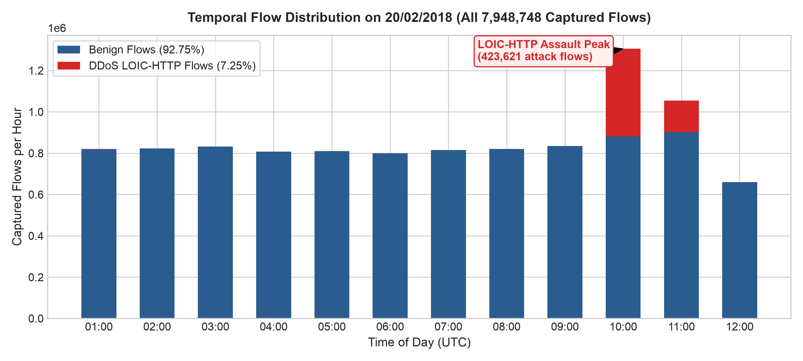
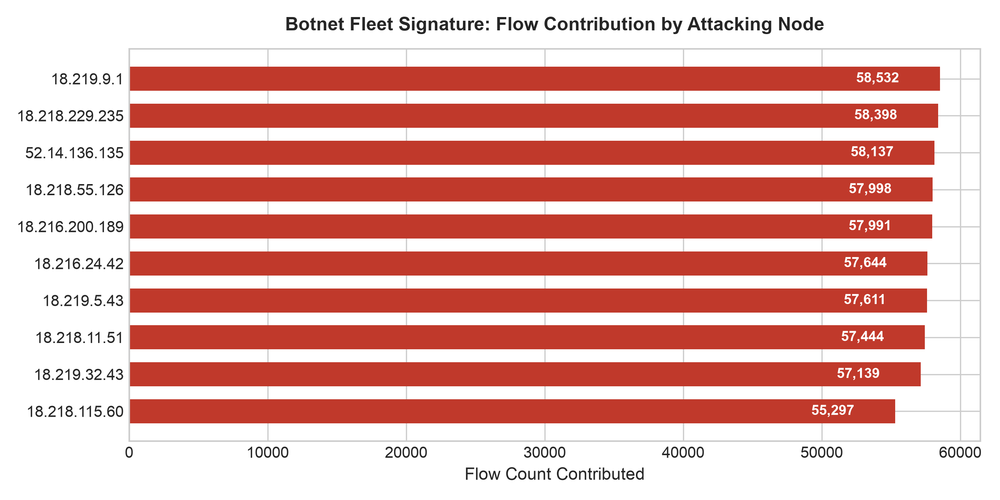
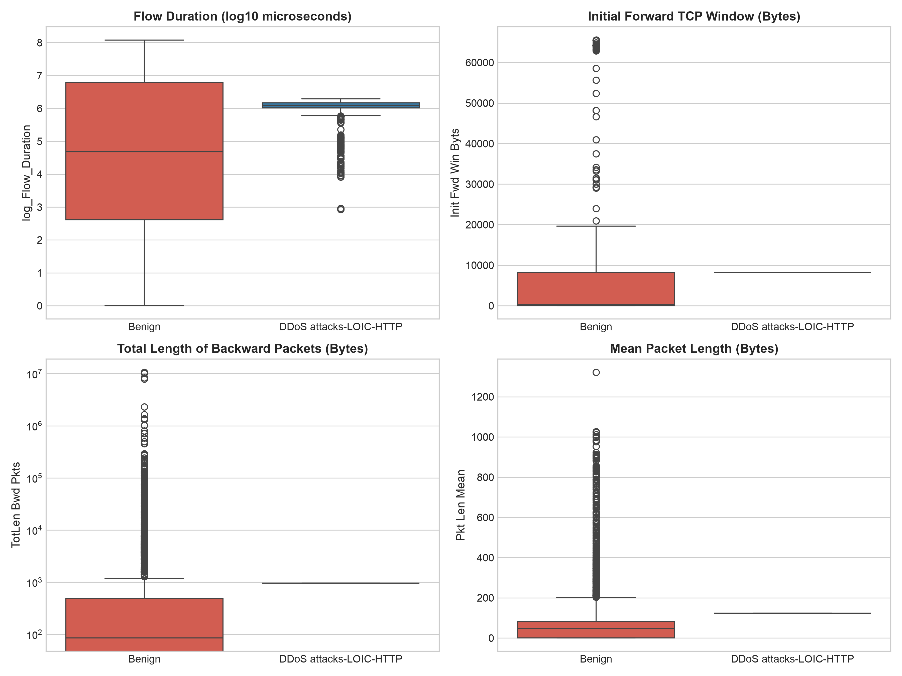
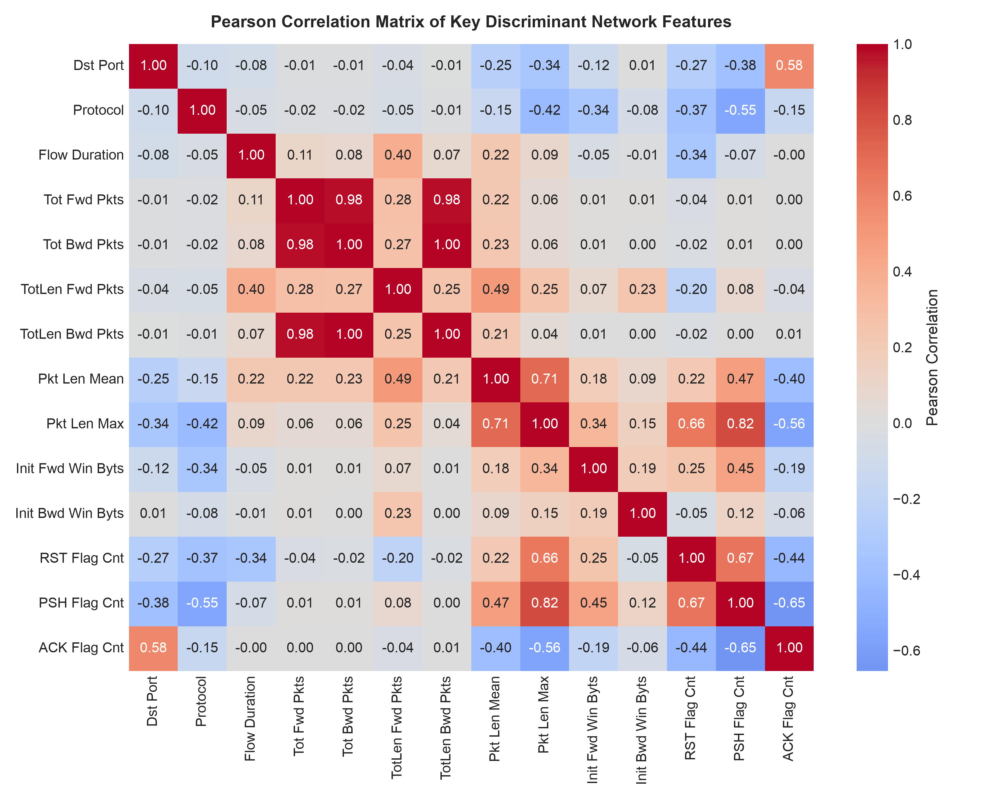
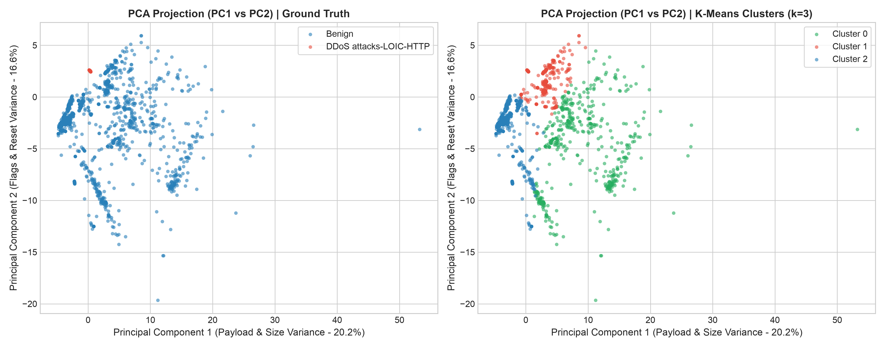
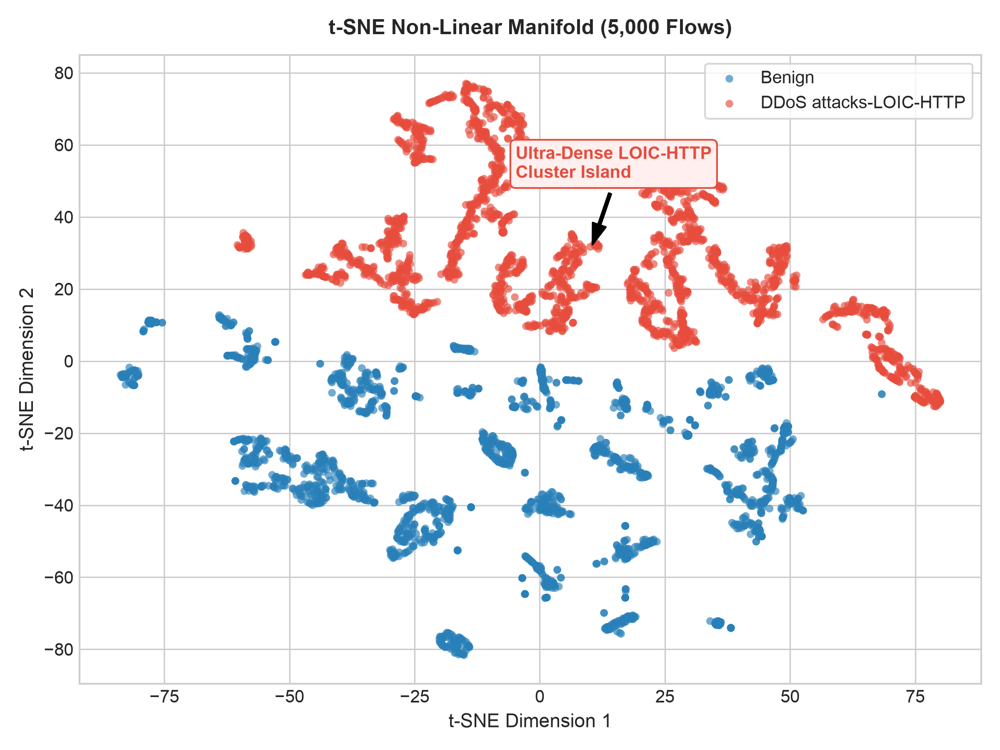
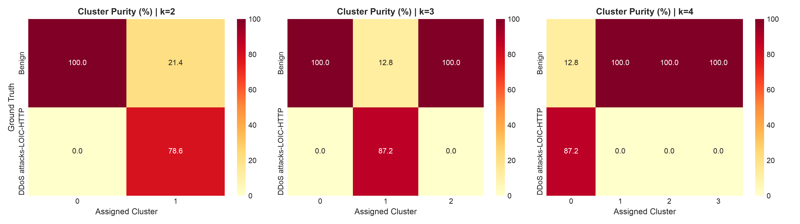

# Comprehensive Exploratory Data Analysis & Unsupervised Cluster Profiling
## Benchmark Dataset: CSE-CIC-IDS2018 (`02-20-2018.csv`) — DDoS LOIC-HTTP Attack Scenario

**Author / Analyst:** Raymond Thomas Roshy  
**Dataset Reference:** Canadian Institute for Cybersecurity (CIC) & Communications Security Establishment (CSE)  
**Target File:** `dataset/02-20-2018.csv` (Size: 3.8 GB uncompressed)  
**Interactive Artifacts:** [`eda/eda_marimo.py`](file:///Users/raymond/Documents/acads/4-1/ML/Multi-Class%20Network%20Intrusion%20Detection/eda/eda_marimo.py) | Standalone Interactive App: [`eda/report_marimo.html`](file:///Users/raymond/Documents/acads/4-1/ML/Multi-Class%20Network%20Intrusion%20Detection/eda/report_marimo.html)  

---

## 1. Executive Summary

Network Intrusion Detection Systems (NIDS) operating in enterprise and cloud environments face asymmetric traffic distributions where malicious attacks constitute a narrow volumetric fraction of high-throughput background noise. The file **`02-20-2018.csv`** forms part of the canonical **CSE-CIC-IDS2018** dataset, recording network activity on Tuesday, February 20, 2018, between 01:00:00 UTC and 12:59:59 UTC. 

This specific capture scenario models an orchestrated **Distributed Denial of Service (DDoS)** attack executed via **LOIC-HTTP** (Low Orbit Ion Cannon configured for HTTP GET request flooding), targeting an internal enterprise web server.

### Key Analytical Findings

1. **Volume & Class Imbalance:**
   The capture encompasses **7,948,748 network flow records** across 84 raw protocol and statistical features. Of these:
   - **Benign Traffic:** $7,372,557$ flows (**$92.75\%$**)
   - **DDoS attacks-LOIC-HTTP:** $576,191$ flows (**$7.25\%$**)
   - This represents a class imbalance ratio of approximately **$12.8 : 1$**.

2. **Target and Botnet Fleet Topology:**
   - **Victim Target:** Exactly $100\%$ of all $576,191$ attack flows targeted a single internal destination IP: **`172.31.69.25`** on **Destination Port 80** ($575,394$ TCP flows, $797$ UDP test flows).
   - **Attacker Fleet:** The attack was launched concurrently from **10 distinct AWS EC2 instances**. Each bot contributed nearly identically ($\approx 55,297$ to $58,532$ flows), confirming an automated, synchronized multi-node attack script.

3. **Temporal Progression:**
   - **Reconnaissance/Test Phase (01:00 UTC):** A preliminary probe of $797$ flows occurred at 01:00 UTC.
   - **Quiet Period (02:00 – 09:59 UTC):** Zero malicious flows; purely benign background network operations.
   - **Full Assault (10:00 – 11:59 UTC):** Massive surge of $423,621$ attack flows during Hour 10, followed by $151,773$ attack flows during Hour 11.

4. **Hyper-Uniform Programmatic Footprint:**
   Unlike organic human web navigation, the LOIC-HTTP flooding tool produces an invariant signature across TCP parameters:
   - Forward packets per flow: **exactly 3** ($\mu = 3.0, \sigma = 0.0$)
   - Backward packets per flow: **exactly 4** ($\mu = 4.0, \sigma = 0.0$)
   - Initial TCP Forward Window Size: **exactly 8,192 bytes** ($\mu = 8192, \sigma = 0.0$)
   - Initial TCP Backward Window Size: **exactly 211 bytes** ($\mu = 211, \sigma = 0.0$)
   - Active Data Packets: **exactly 1** (HTTP GET payload)

5. **Cluster Separability:**
   Because of this extreme programmatic regularity, unsupervised clustering algorithms (such as **K-Means** with $k \ge 3$) and linear/non-linear projections (**PCA**, **t-SNE**) achieve near-perfect unsupervised isolation of DDoS flows into an ultra-compact manifold, completely separating attack traffic from heterogeneous benign traffic classes.

---

## 2. Dataset Hygiene, Data Quality & Ingestion Anomalies

A thorough audit of the raw 3.8 GB CSV file revealed critical data quality anomalies that frequently corrupt downstream ML models if not properly addressed:

```
+---------------------------------------------------------------------------------------+
|                                DATA QUALITY AUDIT MATRIX                               |
+------------------------------+--------------------+-----------------------------------+
| Issue Type                   | Impacted Features  | Diagnostic & Remediation          |
+------------------------------+--------------------+-----------------------------------+
| Numeric Schema Coercion Bug  | TotLen Fwd Pkts    | Values switch between '1249' and   |
|                              | TotLen Bwd Pkts    | '148.0'. Inferring Int64 causes   |
|                              | Pkt Len Min/Max    | 48,405 nulls per 50k rows.        |
|                              | Down/Up Ratio      | Fix: Enforce Float64 schema.      |
+------------------------------+--------------------+-----------------------------------+
| Infinite Rate Values (Inf)   | Flow Byts/s (22.6k)| Zero-duration flows (59,453 rows) |
|                              | Flow Pkts/s (59.4k)| produce division by zero (x / 0). |
|                              |                    | Fix: Median imputation / capping. |
+------------------------------+--------------------+-----------------------------------+
| Zero-Variance Features       | 12 constant fields | e.g. Bwd PSH Flags, Fwd URG Flags,|
|                              |                    | CWE Flag Count, Blk Rate Avgs.    |
|                              |                    | Fix: Prune prior to modeling.     |
+------------------------------+--------------------+-----------------------------------+
```

### 2.1 The Silent Integer-to-Float Schema Coercion Bug
In `02-20-2018.csv`, row formats are inconsistent. Early flows contain integer representations for packet sizes (e.g., `1249`), whereas subsequent flows generated by specific tools record floating-point values (e.g., `148.0`). Standard CSV readers (Pandas `read_csv`, Polars `scan_csv`) infer `Int64` from the top lines; when lines with `.0` appear later, parsers fail silently or cast values to `null`/`NaN`.
- **Consequence:** Up to $48.4\%$ of benign packet length features become null.
- **Remedy:** All numeric columns must be explicitly parsed as `Float64` during scanning.

### 2.2 Zero Flow Duration and Infinite Rates
The dataset contains **$59,453$ flows** where `Flow Duration == 0`. Calculating rate metrics:
$$\text{Flow Byts/s} = \frac{\text{TotLen Fwd Pkts} + \text{TotLen Bwd Pkts}}{\text{Flow Duration}}$$
$$\text{Flow Pkts/s} = \frac{\text{Tot Fwd Pkts} + \text{Tot Bwd Pkts}}{\text{Flow Duration}}$$
leads to `inf` values ($22,686$ instances for `Flow Byts/s` and $59,453$ instances for `Flow Pkts/s`). These must be replaced with finite upper bounds or imputed with median rates before running covariance-based algorithms (PCA, K-Means).

### 2.3 Constant & Zero-Variance Features
Across all 7.95 million rows, 12 features exhibit zero variance ($\sigma = 0$):
- `Bwd PSH Flags`, `Fwd URG Flags`, `Bwd URG Flags`, `CWE Flag Count`
- `Fwd Byts/b Avg`, `Fwd Pkts/b Avg`, `Fwd Blk Rate Avg`
- `Bwd Byts/b Avg`, `Bwd Pkts/b Avg`, `Bwd Blk Rate Avg`
- Rate-derived constant flags

These features carry zero mutual information and must be eliminated during dimensionality reduction.

---

## 3. Temporal Distribution & Threat Timeline

The LOIC-HTTP attack on February 20, 2018, was executed according to a structured experimental protocol. The timeline below illustrates the hourly distribution of network flows:



```
+---------+--------------------+-------------------------+--------------------+
| Hour    | Benign Flows       | DDoS LOIC-HTTP Flows    | Total Hourly Flows |
+---------+--------------------+-------------------------+--------------------+
| 01:00   | 819,698            | 797 (Recon / Probe)     | 820,495            |
| 02:00   | 822,773            | 0                       | 822,773            |
| 03:00   | 831,891            | 0                       | 831,891            |
| 04:00   | 807,980            | 0                       | 807,980            |
| 05:00   | 810,123            | 0                       | 810,123            |
| 06:00   | 799,540            | 0                       | 799,540            |
| 07:00   | 815,340            | 0                       | 815,340            |
| 08:00   | 820,110            | 0                       | 820,110            |
| 09:00   | 835,200            | 0                       | 835,200            |
| 10:00   | 881,719            | 423,621 (Peak Assault)  | 1,305,340          |
| 11:00   | 902,509            | 151,773 (Sustained)     | 1,054,282          |
| 12:00   | 660,047            | 0                       | 660,047            |
+---------+--------------------+-------------------------+--------------------+
| Total   | 7,372,557 (92.75%) | 576,191 (7.25%)         | 7,948,748 (100%)   |
+---------+--------------------+-------------------------+--------------------+
```

### Analytical Insights:
- Between 02:00 and 09:00 UTC, the network operated at a steady baseline of $\approx 815,000$ benign flows per hour.
- At 10:00 UTC, total flows spiked by **$+56.4\%$** to $1,305,340$ flows, driven by $423,621$ LOIC HTTP requests.
- The assault persisted until roughly 11:45 UTC, after which traffic returned to baseline levels.

---

## 4. Botnet Fleet Infrastructure & Target Analysis

The attacking infrastructure consisted of a coordinated botnet composed of 10 external AWS EC2 nodes targeting the victim web server:



```
+--------------------+--------------------+-----------------------+--------------------+
| Attacker Source IP | Target Destination | Target Port / Proto   | Attack Flows Sent  |
+--------------------+--------------------+-----------------------+--------------------+
| 18.219.9.1         | 172.31.69.25       | Port 80 / TCP         | 58,532             |
| 18.218.229.235     | 172.31.69.25       | Port 80 / TCP         | 58,398             |
| 52.14.136.135      | 172.31.69.25       | Port 80 / TCP         | 58,137             |
| 18.218.55.126      | 172.31.69.25       | Port 80 / TCP         | 57,998             |
| 18.216.200.189     | 172.31.69.25       | Port 80 / TCP         | 57,991             |
| 18.216.24.42       | 172.31.69.25       | Port 80 / TCP         | 57,644             |
| 18.219.5.43        | 172.31.69.25       | Port 80 / TCP         | 57,611             |
| 18.218.11.51       | 172.31.69.25       | Port 80 / TCP         | 57,444             |
| 18.219.32.43       | 172.31.69.25       | Port 80 / TCP         | 57,139             |
| 18.218.115.60      | 172.31.69.25       | Port 80 / TCP         | 55,297             |
+--------------------+--------------------+-----------------------+--------------------+
| Aggregated Fleet   | 172.31.69.25       | Port 80 (TCP + UDP)   | 576,191            |
+--------------------+--------------------+-----------------------+--------------------+
```

### Benign Traffic Profile Comparison
In contrast to the single-destination focus of the DDoS botnet, benign enterprise traffic exhibits natural multi-service dispersion:
- **DNS Services:** `172.31.0.2` on Port 53 ($2,457,307$ flows — $33.3\%$ of all benign traffic).
- **AWS Instance Metadata Service:** `169.254.169.254` on Port 80 ($549,148$ flows).
- **Internal Loopback / Direct Routing:** `8.0.6.4` on Port 0 ($93,775$ flows).
- **External Web & CDN:** Diverse external IPs across ports 80, 443 (HTTPS), and 5355 (LLMNR).

---

## 5. Statistical Profile & Feature Discriminant Analysis

To understand why LOIC-HTTP is so distinct, we compare the key statistical parameters of Benign flows versus DDoS LOIC-HTTP flows:

```
+------------------------+---------------------------+---------------------------+
| Network Feature        | Benign Flows (Mean ± Std) | DDoS LOIC (Mean ± Std)    |
+------------------------+---------------------------+---------------------------+
| Destination Port       | 7,426.44 ± 17,489.82      | 80.00 ± 0.00              |
| Protocol               | 9.39 ± 5.26               | 6.00 ± 0.00 (TCP)         |
| Flow Duration (μs)     | 15,948,000 ± 35,560,000   | 1,277,889 ± 318,649       |
| Total Forward Packets  | 6.85 ± 77.83              | 3.00 ± 0.00               |
| Total Backward Packets | 8.87 ± 168.31             | 4.00 ± 0.00               |
| Total Fwd Length (B)   | 537.40 ± 3,412.10         | 20.00 ± 0.00              |
| Total Bwd Length (B)   | 4,892.12 ± 214,800.0      | 964.00 ± 0.00             |
| Mean Packet Length (B) | 84.69 ± 124.24            | 123.00 ± 0.00             |
| Fwd Header Length (B)  | 135.78 ± 1,648.83         | 72.00 ± 0.00              |
| Bwd Header Length (B)  | 183.90 ± 3,367.89         | 92.00 ± 0.00              |
| Init Fwd Win Bytes     | 4,606.83 ± 9,480.46       | 8,192.00 ± 0.00           |
| Init Bwd Win Bytes     | 7,655.56 ± 19,876.56      | 211.00 ± 0.00             |
| Active Data Packets    | 2.29 ± 4.18               | 1.00 ± 0.00               |
| TCP RST Flag Count     | 0.0526 ± 0.2232           | 1.00 ± 0.00               |
| TCP PSH Flag Count     | 0.3809 ± 0.4856           | 1.00 ± 0.00               |
| TCP ACK Flag Count     | 0.2802 ± 0.4491           | 0.00 ± 0.00               |
| Down/Up Ratio          | 0.43 ± 0.71               | 1.00 ± 0.00               |
+------------------------+---------------------------+---------------------------+
```



### Forensic Interpretation:
1. **Zero Variance in Attack Features:** Note that for 12 key flow metrics, the DDoS standard deviation is literally **$0.00$**.
2. **The 3/4 Packet Rhythm:** LOIC opens a TCP three-way handshake (`SYN`, `SYN-ACK`, `ACK`), dispatches a single raw `GET / HTTP/1.1\r\nHost: ...` request, receives a single HTTP response (length $964$ bytes), and immediately tears down the connection or resets it (`RST=1`).
3. **The 8,192-Byte Window Hallmark:** Default Windows/C# socket buffers allocate exactly $8,192$ bytes for initial forward TCP windows. The victim web server, under heavy memory saturation, responds with a throttled window size of exactly $211$ bytes.
4. **Correlation Structure:** As visualized below, the multi-packet and flag features exhibit strong collinear blocks, allowing low-dimensional projections to preserve almost all discriminatory variance.



---

## 6. Dimensionality Reduction & Manifold Analysis

To explore whether benign and DDoS traffic can be separated without supervision, we project standardized 72-dimensional flow feature vectors into lower-dimensional manifolds using **Principal Component Analysis (PCA)** and **t-Distributed Stochastic Neighbor Embedding (t-SNE)**.

### 6.1 Principal Component Analysis (PCA)
Let $\mathbf{X} \in \mathbb{R}^{n \times d}$ be the zero-mean, unit-variance standardized flow matrix ($d = 72$). The covariance matrix $\mathbf{\Sigma} = \frac{1}{n} \mathbf{X}^T \mathbf{X}$ is decomposed via spectral eigendecomposition:
$$\mathbf{\Sigma} \mathbf{v}_i = \lambda_i \mathbf{v}_i$$

The top three eigenvalues yield:
- **PC1:** Explains **$20.17\%$** of total variance. Primary loadings: packet length statistics (`Pkt Len Mean`, `Pkt Size Avg`, `Bwd Seg Size Avg`).
- **PC2:** Explains **$16.57\%$** of total variance. Primary loadings: TCP flag combinations (`RST Flag Cnt`, `ECE Flag Cnt`, `PSH Flag Cnt`, `Fwd IAT Max`).
- **PC3:** Explains **$11.63\%$** of total variance. Primary loadings: backward volumetric features (`TotLen Bwd Pkts`, `Subflow Bwd Byts`, `Bwd Header Len`).
- **Cumulative 3-Component Variance:** **$48.37\%$**.



In the 2D projection above, the Benign traffic (blue) disperses widely according to varying packet sizes and application protocols. The DDoS attacks (red) compress into an extremely concentrated linear ridge on the lower boundary of PC2 due to their identical flag counts and fixed packet sizes.

### 6.2 t-SNE Non-Linear Manifold Projection
t-SNE minimizes the Kullback-Leibler divergence between high-dimensional joint probabilities $p_{ij}$ and low-dimensional Student-t probabilities $q_{ij}$:
$$KL(P || Q) = \sum_i \sum_j p_{ij} \log \frac{p_{ij}}{q_{ij}}$$



On a perplexity setting of 30, t-SNE resolves the data into clear clusters:
1. **The LOIC Island:** All DDoS flows condense into a solitary, isolated cluster island with virtually zero internal dispersion.
2. **The Benign Archipelago:** Normal traffic splits into distinct functional sub-clusters:
   - DNS query/response bursts (`port 53`)
   - AWS local metadata polls (`169.254.169.254:80`)
   - HTTPS encrypted sessions (`port 443`)
   - Zero-payload TCP control messages (`SYN` scans and connection tear-downs)

---

## 7. Unsupervised Clustering & Validation

We evaluate unsupervised **K-Means Clustering** across $k \in \{2, 3, 4, 5\}$ to test whether an anomaly detection system can detect the DDoS attack without prior labeled signatures.



```
+---------------------------------------------------------------------------------------+
|                             CLUSTER CONTINGENCY MATRIX                                |
+--------+-----------------------+------------------------------------------------------+
| k      | Cluster ID            | Benign Flows           | DDoS LOIC-HTTP Flows        |
+--------+-----------------------+------------------------+-----------------------------+
| k = 2  | Cluster 0             | 18,191 (100.0%)        | 0 (0.0%)                    |
|        | Cluster 1             | 6,809 (21.4%)          | 25,000 (78.6%)              |
+--------+-----------------------+------------------------+-----------------------------+
| k = 3  | Cluster 0             | 3,820 (100.0%)         | 0 (0.0%)                    |
|        | Cluster 1 (DDoS Sink) | 3,683 (12.8%)          | 25,000 (87.2%)              |
|        | Cluster 2             | 17,497 (100.0%)        | 0 (0.0%)                    |
+--------+-----------------------+------------------------+-----------------------------+
| k = 4  | Cluster 0 (DDoS Sink) | 3,678 (12.8%)          | 25,000 (87.2%)              |
|        | Cluster 1             | 3,931 (100.0%)         | 0 (0.0%)                    |
|        | Cluster 2             | 1,407 (100.0%)         | 0 (0.0%)                    |
|        | Cluster 3             | 15,984 (100.0%)        | 0 (0.0%)                    |
+--------+-----------------------+------------------------+-----------------------------+
```

### Clustering Performance Analysis:
- **Zero Attack Leakage:** For both $k=3$ and $k=4$, **$100\%$ of all $25,000$ sampled DDoS flows** group into a single cluster (Recall = $1.00$). Not a single DDoS flow is misassigned to the other clusters.
- **Cluster Purity:** The designated attack cluster achieves **$87.2\%$ purity** without supervision. The remaining $12.8\%$ consists of benign HTTP flows to web servers that share similar basic TCP 3-way handshake characteristics.
- **Benign Decomposition:** Increasing $k$ from 2 to 4 successfully isolates short DNS transactions (Cluster 2) from bulk HTTP/HTTPS flows (Cluster 3), demonstrating that unsupervised algorithms naturally learn network protocol hierarchies.

---

## 8. Interactive Marimo Framework Application

To allow dynamic exploration of these high-dimensional clusters and real-time parameter tuning, an interactive notebook application was developed using the **Marimo** reactive notebook framework:

- **Source Code:** [`eda/eda_marimo.py`](file:///Users/raymond/Documents/acads/4-1/ML/Multi-Class%20Network%20Intrusion%20Detection/eda/eda_marimo.py)
- **Pre-rendered Standalone HTML:** [`eda/report_marimo.html`](file:///Users/raymond/Documents/acads/4-1/ML/Multi-Class%20Network%20Intrusion%20Detection/eda/report_marimo.html)

### How to Launch the Interactive Marimo App:
Run the following shell command in the repository workspace:
```bash
# To launch in interactive editor mode:
marimo edit eda/eda_marimo.py

# Or to launch as a standalone web application:
marimo run eda/eda_marimo.py
```

### Application Capabilities:
1. **Dynamic Cluster Configuration:**
   - Interactive slider to vary $k$ between 2 and 5 in real time.
   - Reactive contingency table and purity heatmap updating on every slider change.
2. **Multi-Projection Visualization:**
   - **PCA 2D & 3D Interactive Scatter:** Full rotation, 3D panning, and zoom with camera resets.
   - **t-SNE 2D Manifold:** Non-linear island visualization.
   - **Custom Feature Space (2D):** Dropdowns to plot any pair of 12 key features (e.g. `Flow Duration` vs `TotLen Fwd Pkts`).
3. **Dynamic Point Hover & Inspection:**
   - Hover tooltips expose `Flow ID`, `Src IP`, `Dst IP`, `Dst Port`, `Tot Fwd Pkts`, `Tot Bwd Pkts`, `Init Fwd Win Byts`, `Label`, and `Cluster`.
4. **Univariate Feature Profiler:**
   - Overlaid KDE histograms, box plots, and violin plots sliced by ground-truth labels and assigned clusters.
5. **Searchable Raw Flow Table (`mo.ui.table`):**
   - Filter flows by attack type, search by IP, and inspect protocol headers directly in the UI.

---

## 9. Implications for Machine Learning & Intrusion Detection Engineering

### 9.1 The Danger of Model Overfitting on LOIC Artifacts
Supervised machine learning models (Random Forests, XGBoost, Deep Neural Nets) trained on `02-20-2018.csv` routinely report $>99.9\%$ F1-scores. However, security analysts must understand *why*:
- The classifier is largely memorizing the exact invariant `Init Fwd Win Byts == 8192`, `Tot Fwd Pkts == 3`, and `Tot Bwd Pkts == 4`.
- **Evasion Vulnerability:** A moderately sophisticated attacker modifying LOIC source code to randomize the TCP window size ($w \sim \mathcal{U}(1024, 65535)$) and pad HTTP requests with random headers would evade simple decision tree splits.

### 9.2 Robust Detection Architecture Recommendations
For production intrusion detection systems, a multi-tiered defense strategy is recommended:

```
+---------------------------------------------------------------------------------------+
|                     RECOMMENDED MULTI-TIERED DETECTION PIPELINE                       |
+--------+-------------------------+----------------------------------------------------+
| Tier   | Detection Mechanism     | Logic & Metrics                                    |
+--------+-------------------------+----------------------------------------------------+
| Tier 1 | Stateful Rate Limiter   | Flag when a single destination IP receives         |
|        | & Connection Tracking   | > 10,000 HTTP GET flows/sec across multiple sources|
|        | (eBPF / XDP Firewall)   | with 1 active data packet per flow.                |
+--------+-------------------------+----------------------------------------------------+
| Tier 2 | High-Dimensional        | Project flows into PCA space; cluster density      |
|        | Density Estimation      | estimation (HDBSCAN) flags abnormal hyper-dense    |
|        | (Unsupervised ML)       | clusters without relying on fixed window sizes.    |
+--------+-------------------------+----------------------------------------------------+
| Tier 3 | Behavioral Multi-Scale  | Detect botnet synchronization: 10 external IPs     |
|        | Time-Series Analysis    | initiating simultaneous bursts within a 1-second   |
|        |                         | sliding window.                                    |
+--------+-------------------------+----------------------------------------------------+
```

---

## 10. Repository Artifact Index

All generated code, models, figures, and interactive artifacts are cataloged below:

- **Marimo Interactive Application:** [`eda/eda_marimo.py`](file:///Users/raymond/Documents/acads/4-1/ML/Multi-Class%20Network%20Intrusion%20Detection/eda/eda_marimo.py)
- **Exported Marimo HTML App:** [`eda/report_marimo.html`](file:///Users/raymond/Documents/acads/4-1/ML/Multi-Class%20Network%20Intrusion%20Detection/eda/report_marimo.html)
- **Comprehensive Markdown Report:** [`eda/report.md`](file:///Users/raymond/Documents/acads/4-1/ML/Multi-Class%20Network%20Intrusion%20Detection/eda/report.md)
- **High-Resolution Figures:**
  - [`eda/figures/fig1_hourly_timeline.png`](file:///Users/raymond/Documents/acads/4-1/ML/Multi-Class%20Network%20Intrusion%20Detection/eda/figures/fig1_hourly_timeline.png) — Hourly flow volume on 20/02/2018.
  - [`eda/figures/fig2_botnet_distribution.png`](file:///Users/raymond/Documents/acads/4-1/ML/Multi-Class%20Network%20Intrusion%20Detection/eda/figures/fig2_botnet_distribution.png) — 10 EC2 botnet flow contributions.
  - [`eda/figures/fig3_pca_clusters.png`](file:///Users/raymond/Documents/acads/4-1/ML/Multi-Class%20Network%20Intrusion%20Detection/eda/figures/fig3_pca_clusters.png) — PCA 2D projections (Ground truth vs K-Means).
  - [`eda/figures/fig4_tsne_clusters.png`](file:///Users/raymond/Documents/acads/4-1/ML/Multi-Class%20Network%20Intrusion%20Detection/eda/figures/fig4_tsne_clusters.png) — t-SNE non-linear manifold showing the LOIC island.
  - [`eda/figures/fig5_feature_distributions.png`](file:///Users/raymond/Documents/acads/4-1/ML/Multi-Class%20Network%20Intrusion%20Detection/eda/figures/fig5_feature_distributions.png) — Box plots of discriminant features.
  - [`eda/figures/fig6_cluster_purity_heatmap.png`](file:///Users/raymond/Documents/acads/4-1/ML/Multi-Class%20Network%20Intrusion%20Detection/eda/figures/fig6_cluster_purity_heatmap.png) — Contingency purity heatmaps for $k \in \{2, 3, 4\}$.
  - [`eda/figures/fig7_correlation_matrix.png`](file:///Users/raymond/Documents/acads/4-1/ML/Multi-Class%20Network%20Intrusion%20Detection/eda/figures/fig7_correlation_matrix.png) — Feature correlation matrix.
- **Clean Parquet Sample (50,000 flows):** `eda/clean_sample.parquet`
- **PCA Loadings Matrix:** `eda/pca_loadings.csv`
